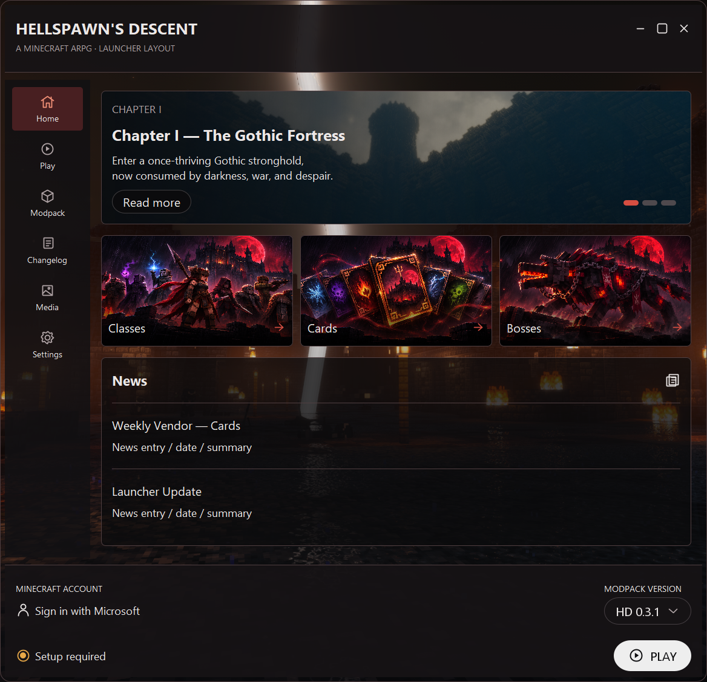
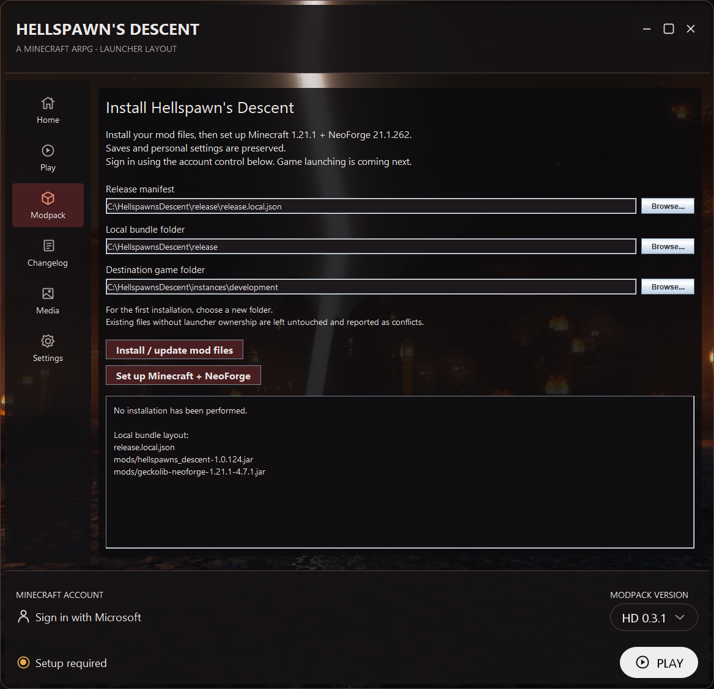
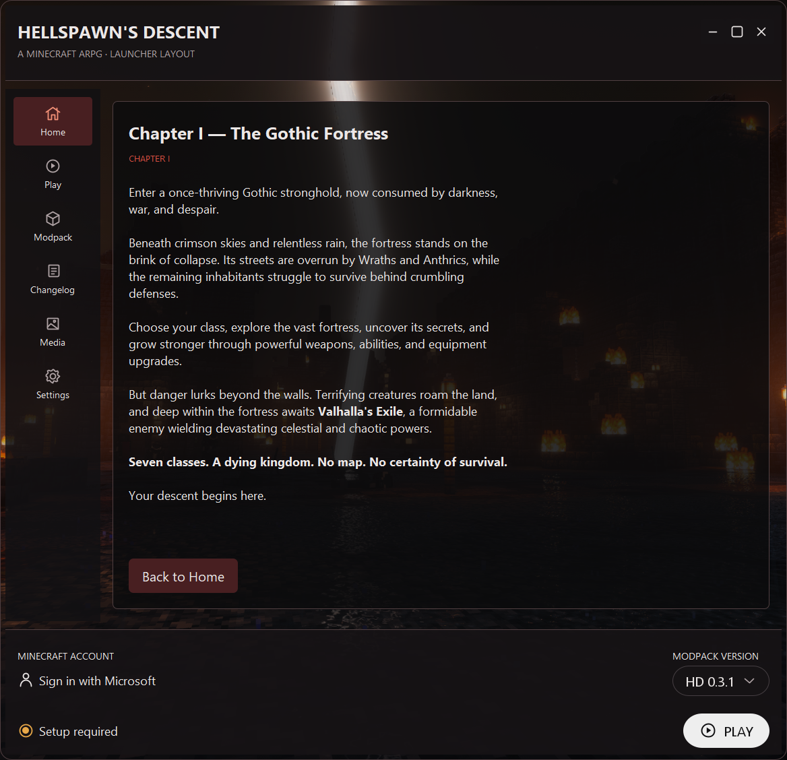

# hellspawns-launcher-info
An independent Windows desktop launcher currently under development
for the Hellspawn's Descent Minecraft: Java Edition modpack.

The launcher installs and updates modpack files and sets up Minecraft
1.21.1 with NeoForge. Microsoft sign-in uses Microsoft's website.
Minecraft API access is being requested to verify Java Edition access
and retrieve the player's profile before launching.

Passwords are entered only on Microsoft's website. Authentication
tokens currently remain in memory for the launcher session.

This project is not affiliated with Mojang or Microsoft.

Contact: Please open an issue in this repository.

## Launcher screenshots

These screenshots show the current development build. Minecraft API approval is
pending, and the Play button remains disabled while game launching is developed.
The setup screenshot uses example local folder paths.

### Home

Featured chapter, Classes / Cards / Bosses artwork, news placeholders, and the
Microsoft account control.

### Modpack setup

Local mod-file installation and updates, plus automatic Minecraft 1.21.1 and
NeoForge 21.1.262 runtime setup. Saves and personal settings are preserved.

### Chapter I

The Gothic Fortress chapter description, opened through Read more.

